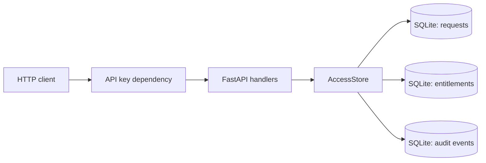
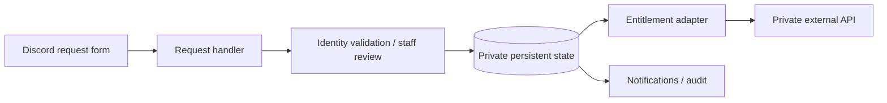

# Priority Access Bot — FastAPI Backend Demo

**Private Discord entitlement workflow · Public synthetic REST API sample**

[](https://github.com/Scumbagsss/priority-access-bot/actions/workflows/api-demo.yml)


> **Two distinct parts:** The commercial Discord priority-access application remains **private** and is not deployable from this repository. The `api_demo/` directory is a separate **runnable, synthetic FastAPI backend** designed to demonstrate Python engineering skills without exposing the actual API or player data.

## What problem does priority access solve?

Server priority access involves identity checks, staff approval, entitlement state, database consistency and error handling. Simply adding a Discord role does not implement a complete access workflow.

The private application integrates Discord interactions and a real server's access services. Its full code, customer information and private API are not published.

## Public runnable FastAPI demonstration

This standalone API implements a **fictional, local-only** version of the request lifecycle:

- `POST /requests`: authenticated member creates a pending request; repeated submission returns the existing pending request.
- `GET /requests`: staff list/paginate requests.
- `GET /requests/{id}`: owner or staff can inspect a request.
- `POST /requests/{id}/approve`: staff grants exactly one **local SQLite entitlement** in an atomic transaction.
- `POST /requests/{id}/reject`: staff rejects with a required reason.
- `GET /requests/{id}/events`: owner/staff view audit history.
- `GET /entitlements/me`: inspect fictional entitlements and calculated expiry.
- `GET /health`: minimal health response.



**Not connected to Steam or DayZ.** SteamID64-shaped values are checked for syntax only. The demo does not verify ownership or issue real server privileges.

### Run locally

Requires Python **3.11+**. Use two different, newly generated demo API keys; no actual keys are included in the repository.

```bash
python -m pip install -r requirements-demo.txt
export DEMO_MEMBER_TOKEN="$(python -c 'import secrets; print(secrets.token_urlsafe(24))')"
export DEMO_STAFF_TOKEN="$(python -c 'import secrets; print(secrets.token_urlsafe(24))')"
uvicorn api_demo.main:create_app_from_env --factory --host 127.0.0.1 --port 8000
```

Visit **http://127.0.0.1:8000/docs** for the interactive OpenAPI explorer.

Run the synthetic HTTP and database tests:

```bash
python -m pytest -q tests/test_api_demo.py
```

GitHub Actions runs the API tests on Python 3.11, 3.12 and 3.13. The tests cover validation, authorization, duplicate requests, concurrent approvals, expiration projection and audit history.

For curl examples and detailed implementation boundaries, read [the API walkthrough](docs/API_DEMO.md).

## Private production system: high-level architecture only



Production-specific concerns include Steam account registration checks, entitlement lifecycle management, approval rules, API failures and replay-safe delivery. **Actual private API adapters and business rules are not included here.** This diagram is a conceptual boundary, not a fully verified deployment map.

See [private architecture](docs/ARCHITECTURE.md) and [failure modes](docs/FAILURE_MODES.md).

## Repository layout

| Path | Purpose |
| --- | --- |
| [`api_demo/main.py`](api_demo/main.py) | Runnable fictional FastAPI app + SQLite service |
| [`tests/test_api_demo.py`](tests/test_api_demo.py) | HTTP, transaction and permission tests |
| [`requirements-demo.txt`](requirements-demo.txt) | Demo/test dependencies |
| [`.github/workflows/api-demo.yml`](.github/workflows/api-demo.yml) | CI matrix |
| [`docs/API_DEMO.md`](docs/API_DEMO.md) | Example calls and security/consistency notes |
| [`src/public_interface.py`](src/public_interface.py) | **Unimplemented** production interface sketch |
| [`NOTICE.md`](NOTICE.md) | Disclosure boundary |

## Security note

The API uses keys from environment variables and binds locally by default in the example command. The key-to-identity map is an **illustrative testing mechanism**, not production authentication. Never expose this example on the public internet without replacing its authentication, authorization model and operational safeguards.

**Contact:** Discord — `scumbagsss` · Telegram — [@dilarion](https://t.me/dilarion)

**Author:** [Scumbagsss](https://github.com/Scumbagsss) · Python Backend · Automation
