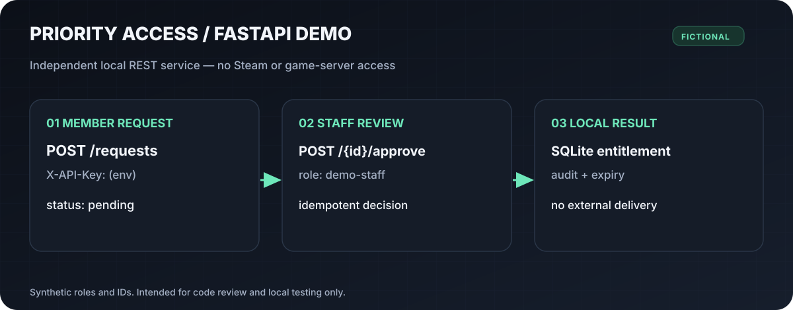
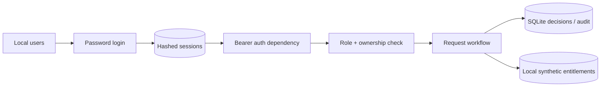

# Priority Access API — Python Backend & Authentication Demo

**FastAPI · SQLite · Session authentication · Authorization · Transactional workflows**

[](https://github.com/Scumbagsss/priority-access-bot/actions/workflows/api-demo.yml)


> **Original synthetic backend, not a real DayZ service.** The production Discord priority bot and integrations remain private. Public examples use fictional identities, a local SQLite database and **no** external Steam/DayZ access.



*Concept illustration: local-only simulated entitlements, not production screenshots.*

## The backend problem

An access-request workflow combines user identity, staff permissions, approval state, safe retries and audit records. A real backend cannot trust a client-supplied role or repeat external delivery blindly.

This repository includes a **self-contained FastAPI demonstration** that covers part of those challenges without exposing the commercial application.

## Authentication added to the public demo

- User accounts are **explicitly provisioned locally** by a CLI, not through open signup.
- Passwords are stored as salted **scrypt** hashes, never in plaintext.
- Login issues random, **60-minute opaque bearer sessions**; only SHA-256 session-token hashes are stored in SQLite.
- Logout revokes the session immediately.
- Each request reloads the user's enabled status and staff role from SQLite, so changes apply to existing sessions.
- All application permissions are checked server-side. Staff can view/review requests; members can view only their own.
- Invalid, expired or revoked sessions receive HTTP 401.

The demo is **not a production identity provider**: it omits request throttling, OAuth/SSO, TLS termination, MFA and deployment hardening. It is intended for local review only.

## Run locally

Requires Python 3.11+ and the dependencies in [requirements-demo.txt](requirements-demo.txt).

```bash
python -m pip install -r requirements-demo.txt
python -m api_demo.manage --db priority-demo.sqlite3 create-user --username demo-member
python -m api_demo.manage --db priority-demo.sqlite3 create-user --username demo-moderator --staff
uvicorn api_demo.main:create_app_from_env --factory --host 127.0.0.1 --port 8000
```

The CLI **prompts for separate passwords** and does not put them in process arguments or source files. Then open [local OpenAPI docs](http://127.0.0.1:8000/docs). Use `POST /auth/login` to obtain a bearer session; pass it as `Authorization: Bearer <token>`.

### Verify

```bash
python -m pytest -q tests/test_api_demo.py
```

GitHub Actions validates the synthetic API on Python 3.11, 3.12 and 3.13. Tests include HTTP login/logout, session expiry, password hashing, role changes, access boundaries, approval idempotency, concurrency and audit persistence.

## Endpoint summary

| Method | Endpoint | Permission |
|---|---|---|
| POST | `/auth/login` | Password login for provisioned local user |
| POST | `/auth/logout` | Authenticated session holder |
| GET | `/auth/me` | Authenticated session holder |
| POST | `/requests` | Authenticated |
| GET | `/requests` | Staff only |
| GET | `/requests/{id}` | Owner or staff |
| POST | `/requests/{id}/approve` | Staff only |
| POST | `/requests/{id}/reject` | Staff only |
| GET | `/requests/{id}/events` | Owner or staff |
| GET | `/entitlements/me` | Authenticated |

Approval creates only a **fictional SQLite entitlement** in one transaction. It does not grant a real DayZ priority or validate real Steam ownership.

## Architecture



See the [complete API walkthrough](docs/API_DEMO.md), [security notes](SECURITY.md) and [failure-mode analysis](docs/FAILURE_MODES.md).

## Public/private boundary

- [`api_demo/auth.py`](api_demo/auth.py) — independent demo auth/session store
- [`api_demo/main.py`](api_demo/main.py) — FastAPI + local workflow service
- [`api_demo/manage.py`](api_demo/manage.py) — password-prompted local account creation
- [`tests/test_api_demo.py`](tests/test_api_demo.py) — synthetic HTTP/database tests
- [`src/public_interface.py`](src/public_interface.py) — **unimplemented** commercial interface sketch

The private Discord implementation, real identity service adapters, API endpoints, secrets and player data are not released.

**Contact:** Discord `scumbagsss` · Telegram [@dilarion](https://t.me/dilarion)
