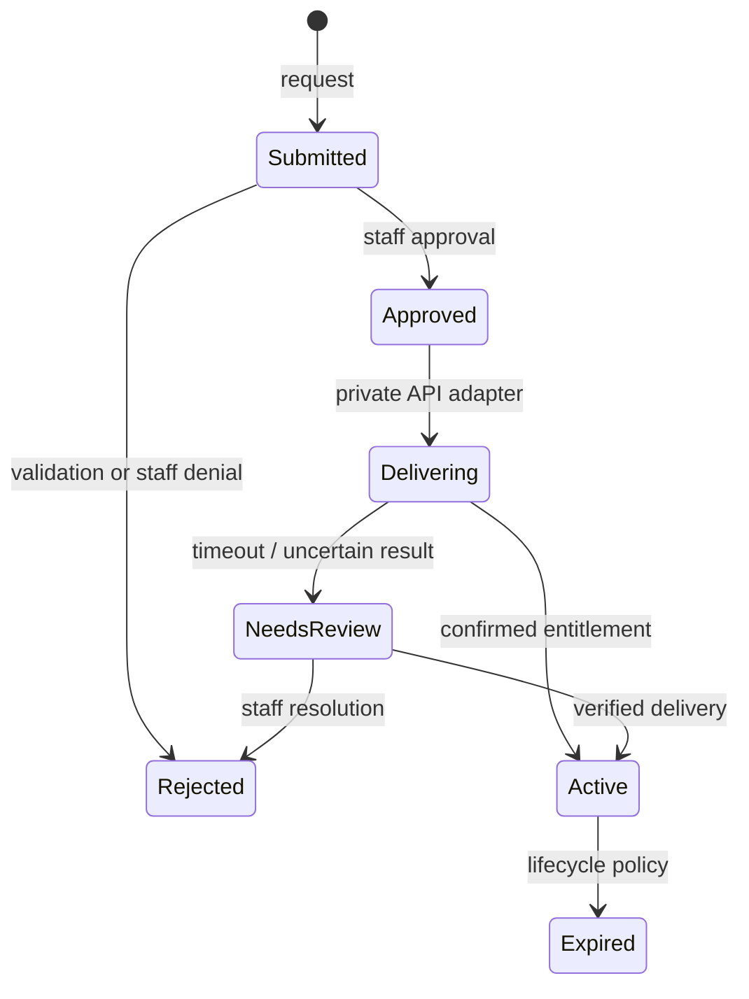
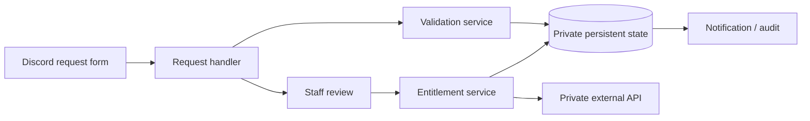

# Priority Access Bot

**A Discord-based entitlement approval workflow for private game-server communities.**

> **Portfolio case study, not a runnable bot.** Production source and API adapters are intentionally private; the public `src/public_interface.py` shows interface signatures only.

## What problem does this solve?

Priority access for a game server is more than granting a role in Discord. A reliable workflow must validate a player's identity, prevent accidental repeat requests, route approvals to authorized staff, communicate with an external entitlement service and preserve an auditable result.

This project documents the system boundaries and backend concerns of a private Discord-driven priority-access workflow.

## Request lifecycle

*This is a **conceptual state machine** for discussing design requirements; it is not evidence that all these states exist in the public skeleton or in every production deployment.*

## Key backend concerns

| Concern | How the workflow is designed to address it |
|---|---|
| Identity validation | Check Steam64-like identifier syntax and query registration via an external adapter |
| Authorization | Staff-only review actions with explicitly configured roles |
| Request state | Distinguish pending, rejected, approved and delivery outcomes |
| Duplicate delivery | Define idempotent delivery behavior rather than reissuing on retries |
| Unavailable API | Preserve uncertain outcomes for reconciliation, not blind success claims |
| Auditability | Record who requested, reviewed and delivered an entitlement |
| Expiry | Model entitlement end-of-life and any renewal policy explicitly |

**Important:** exact policies and feature availability vary by deployment and are not independently verified by this public repository.

## Architecture

**Tech context:** Python, discord.py, aiohttp, SQLite and REST API integrations. The production adapters, keys, endpoints and full database implementation are excluded.

Read [Architecture](docs/ARCHITECTURE.md) and [Failure and security design](docs/FAILURE_MODES.md).

## Public repository contents

- [`src/public_interface.py`](src/public_interface.py) — intentionally unimplemented architectural signatures
- [`docs/ARCHITECTURE.md`](docs/ARCHITECTURE.md) — layer responsibilities and data flow
- [`docs/FAILURE_MODES.md`](docs/FAILURE_MODES.md) — error handling, security and consistency considerations
- [`examples/config.example.jsonc`](examples/config.example.jsonc) — illustrative, non-production configuration
- [`NOTICE.md`](NOTICE.md) — publication boundary

## What can be evaluated?

This showcase explains a real integration problem and the engineering decisions it creates. It does **not** claim to demonstrate executable backend logic in this repository. For a runnable self-contained Python example with persistence, authorization and automated tests, see [Discord Ticket Backend Demo](https://github.com/Scumbagsss/advanced-discord-ticket-bot).

**Author:** [Scumbagsss](https://github.com/Scumbagsss) · Python backend · automation

**Contact:** Discord — `scumbagsss` · Telegram — [@dilarion](https://t.me/dilarion).
