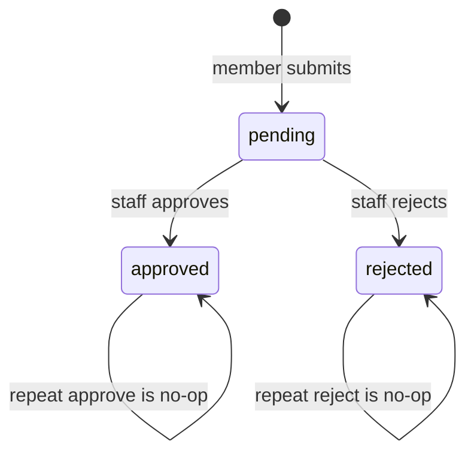

# Synthetic FastAPI demo — authentication, requests and SQLite

> Independent local-only Python backend. Not a production Discord or DayZ API and does not grant actual game access.

## Setup

```bash
python -m pip install -r requirements-demo.txt
python -m api_demo.manage --db priority-demo.sqlite3 create-user --username demo-member
python -m api_demo.manage --db priority-demo.sqlite3 create-user --username demo-moderator --staff
uvicorn api_demo.main:create_app_from_env --factory --host 127.0.0.1 --port 8000
```

Run all commands from the repository root. The CLI uses `getpass` to request a password twice. Choose a distinct strong password for each fictional account. The Uvicorn factory reads `DEMO_DB_PATH` if set (otherwise `priority-demo.sqlite3`). No production credentials are required.

### Authentication examples

Use HTTP JSON to log in:

```bash
curl -X POST http://127.0.0.1:8000/auth/login \
  -H "Content-Type: application/json" \
  -d '{"username":"demo-member","password":"YOUR_LOCAL_DEMO_PASSWORD"}'
```

The response contains a random `access_token`, `token_type: bearer` and an expiry timestamp. Use that token in subsequent calls:

```bash
curl http://127.0.0.1:8000/auth/me -H "Authorization: Bearer YOUR_SESSION_TOKEN"
curl -X POST http://127.0.0.1:8000/requests \
  -H "Authorization: Bearer YOUR_SESSION_TOKEN" \
  -H "Content-Type: application/json" \
  -d '{"steam_id":"76561198000000001","reason":"Synthetic demonstration request"}'
```

The moderator's separately obtained session can approve an existing request ID using `POST /requests/{id}/approve`. Use `POST /auth/logout` with the session header to revoke it. For interactive calls, open `http://127.0.0.1:8000/docs`.

**Never send passwords or tokens to public services.** Commands above are for local loopback testing.

## Identity and authorization

1. Operators create fictional local users through the CLI; account provisioning has **no HTTP endpoint**.
2. Login validates salted scrypt password hashes and returns a cryptographically random opaque token.
3. The database stores only a hash of the token; token possession authenticates the caller for at most 60 minutes.
4. Every API request resolves the token from SQLite, verifies expiry and account status, and fetches the **current** staff flag.
5. Logout deletes the corresponding session row, immediately rejecting future use.
6. Staff permissions and request ownership are enforced by backend services independently of client UI.

A hidden button or client-provided `staff=true` cannot grant authority.

## Request lifecycle



A database partial UNIQUE index prevents duplicate pending requests for the same synthetic account and SteamID-like value. SQLite `BEGIN IMMEDIATE` serializes approval decisions. Exactly one local entitlement row is inserted on approval; audit rows record each decision.

In this **demo** the local entitlement expires after three hours. Reading expired state does not remove real server permissions—no external service is contacted.

## Endpoints

| HTTP | Path | Requirement |
|---|---|---|
| GET | `/health` | Public |
| POST | `/auth/login` | Existing local account + password |
| GET | `/auth/me` | Active session |
| POST | `/auth/logout` | Active session |
| POST | `/requests` | Active session |
| GET | `/requests` | Staff |
| GET | `/requests/{id}` | Request owner or staff |
| POST | `/requests/{id}/approve` | Staff |
| POST | `/requests/{id}/reject` | Staff |
| GET | `/requests/{id}/events` | Request owner or staff |
| GET | `/entitlements/me` | Active session |

## Security decisions and limitations

**Implemented in demo:** salted password hashing, randomly generated tokens, hashed token storage, expiry/revocation, role checks from database, owner isolation, bound SQL, atomic decisions, generic login errors.

**Not implemented:** rate limiting, account lockout, password reset, email verification, MFA, identity federation, production credential management, TLS termination, CSRF protections for browser cookies (cookies aren't used), distributed session cache, monitoring, Alembic migrations, incident response processes.

The example is **not suitable for public deployment** without those safeguards and a thorough independent review. SteamID-like syntax is not proof of account ownership or registration. Neither entitlement creation nor expiry is connected to DayZ.

## Test suite

```bash
python -m pytest -q tests/test_api_demo.py
```

The tests use fictional accounts and an injected clock for deterministic session expiry. CI runs against Python 3.11–3.13. The suite covers both HTTP responses and SQLite state, including revocation, role changes, concurrent approvals and audit events.
