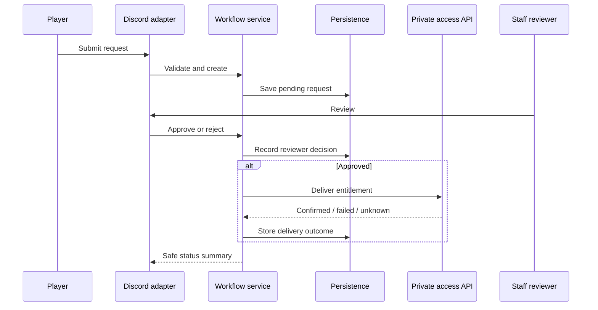

# Priority-access integration architecture

This is a **conceptual design document** for a private-source integration. The public interface is not an implementation.

## Boundaries

- **Discord adapter**: collect application details, handle interaction responses and restrict staff actions.
- **Validation**: validate supplied identifiers and use an external identity service to check registration.
- **Workflow state**: persist the request, reviewer identity, delivery attempts and current status.
- **Entitlement adapter**: translate an approved request into a private service API call.
- **Audit and notification**: report state changes and distinguish confirmed success from uncertain outcomes.

## Important design questions

1. **Authorization**: server-side staff role checks are necessary; a visible Discord button is not an access boundary.
2. **Identity**: syntactic Steam64 validation alone does not prove registration or ownership.
3. **Exactly-once effects**: requests to external APIs may be retried after timeout; use an idempotency key or reconcile status before another delivery.
4. **Concurrency**: concurrent approvals need transactional state transitions to prevent double grants.
5. **Credentials**: API keys, real endpoints and production guild IDs must never be committed.
6. **Expiry**: renewal policies need explicit state, scheduling and failure handling.

Actual production policy, API schemas and entitlement logic are intentionally private.
