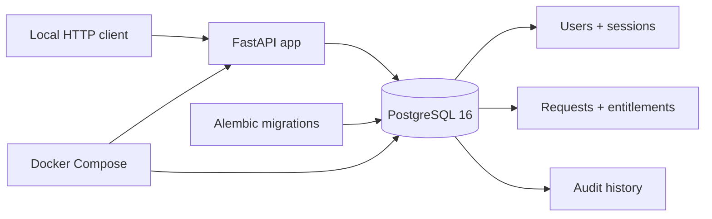

# PostgreSQL + Docker deployment — fictional Priority Workflow

> **What this is:** a deployable educational backend using FastAPI, SQLAlchemy 2, PostgreSQL 16, Alembic, and Docker Compose. It has no Discord, Steam, payment, or game-server connection. Approval creates a local database row only. **Not safe for unrestricted internet exposure** without further hardening.

## Prerequisites

- Docker Engine + Docker Compose V2 (or Docker Desktop) on Windows, Linux or macOS.
- Free local TCP port 8000 (or change `APP_PORT`).
- A unique locally generated PostgreSQL password.

## Start from scratch

```bash
cp deployment.env.example .env
```

Edit `.env`, changing `POSTGRES_PASSWORD` to a **long random password**. It is a real database password, not the literal example value. The `.env` file is gitignored. Run:

```bash
docker compose up -d --build --wait
docker compose ps
```

By design the API binds only to your computer at **http://127.0.0.1:8000**. The PostgreSQL port is not published. The API container waits until the database passes its readiness check, then executes `alembic upgrade head` **before** starting Uvicorn.

Useful endpoints:

- `http://127.0.0.1:8000/health` — process health; no database query
- `http://127.0.0.1:8000/ready` — PostgreSQL readiness
- `http://127.0.0.1:8000/docs` — interactive OpenAPI reference

## Create fictional accounts (manual provisioning)

The application starts with **no accounts**. Create a regular user and a moderator. These commands prompt for passwords interactively; don't pass passwords as CLI flags:

```bash
docker compose exec -it api python -m postgres_app.cli demo-member
docker compose exec -it api python -m postgres_app.cli demo-moderator --staff
```

Run commands in a terminal supporting interactive input (for some shells, omit `-it` if appropriate). Use two distinct passwords.

Log in from the OpenAPI page using `POST /auth/login` and the appropriate fictional username/password. Copy the returned bearer token into Swagger's **Authorize** control. Then use the remaining endpoints to create a fake request and review it using the moderator account.

The sample SteamID `76561198000000001` is **fictional** and has no network lookup or ownership validation.

## Database migrations

The schema is created exclusively by a versioned Alembic migration:

```bash
docker compose exec api alembic current
docker compose exec api alembic history
docker compose exec api alembic upgrade head
```

Never use `Base.metadata.create_all()` to bypass migrations. Review migration code before applying to a persistent environment. The initial revision `0001_initial` creates account/session/request/entitlement/audit tables and a **PostgreSQL partial unique index** to prevent duplicate pending requests for the same actor and SteamID-shaped value.

For **new schema changes**, add a new revision, review generated SQL, and test upgrade/rollback on disposable data first. Do not run simultaneous competing migration processes.

## Persistence and shutdown

The `pgdata` Docker volume survives `docker compose down`. To stop without erasing the demo database:

```bash
docker compose down
```

To deliberately **erase every fictional record**:

```bash
docker compose down -v
```

Use `down -v` only when you want to delete the local database volume. In actual deployments configure scheduled backups, restore tests, storage monitoring and volume lifecycle policies. This demonstration provides none of those.

## Local development without Compose

With a disposable PostgreSQL database already running, export `POSTGRES_HOST`, `POSTGRES_DB`, `POSTGRES_USER`, `POSTGRES_PASSWORD` (and optionally `POSTGRES_PORT`). Then:

```bash
python -m pip install -r requirements-postgres-dev.txt
alembic upgrade head
python -m pytest -q tests_postgres
uvicorn postgres_app.api:app_factory --factory --host 127.0.0.1 --port 8000
```

**Tests are destructive:** `tests_postgres` truncates application tables and **refuses to run unless the database name is exactly `priority_test`**. Never point tests at a database containing real information. GitHub Actions provisions a fresh disposable PostgreSQL 16 service and runs migrations before executing tests.

## Security and operational boundaries

- PostgreSQL credentials are read from environment variables and converted to a SQLAlchemy URL without string-concatenation issues; don't commit your `.env`.
- PostgreSQL has no exposed host port. API is mapped to localhost only.
- Application runs in a non-root container.
- Passwords use salted scrypt; bearer tokens are random, short-lived (30 minutes), hashed at rest and revocable.
- Roles are re-read from PostgreSQL for each request. Staff decisions lock the request row with `SELECT ... FOR UPDATE`. A database partial unique index handles simultaneous submissions.
- **Missing before internet deployment:** login throttling, MFA/SSO, TLS and reverse proxy configuration, structured monitoring, centralized secrets storage, backup/restore, request quotas, security headers and independent threat review.
- This project has **no external entitlement delivery**, so expiry is a local read-time status and cannot revoke real DayZ access.
- `docker compose config` may print environment values; do not share its output or CI logs containing real database credentials.

## Architecture



For the smaller no-Docker demonstration, see the original [SQLite API walkthrough](API_DEMO.md). Both applications are separate and maintain separate databases.
